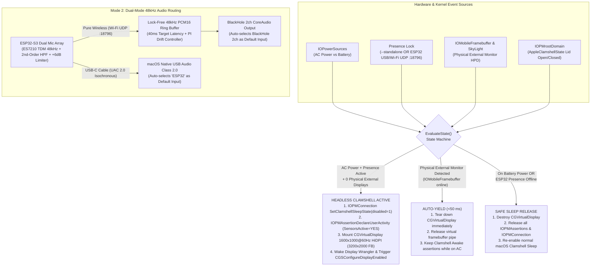

# clamshell-ghost

**Zero-Dongle macOS Headless Clamshell HiDPI Virtual Display & Keep-Awake Daemon — with Optional ESP32-S3 48kHz Wireless/USB Array Microphone Dock**

[](LICENSE)
[-silver)](mac-smart-dummy/README.md)
[](usb-mic-firmware/README.md)

`clamshell-ghost` turns any MacBook into a zero-dongle, closed-clamshell remote workstation with crisp **16:10 HiDPI (`1600x1000@60Hz`, `3200x2000` backing framebuffer)** rendering, instant `<50 ms` **Auto-Yield** when physical monitors are connected, and automatic sleep recovery when unplugged from AC power.

Pair it with an optional **ESP32-S3 dual-microphone dock** (`usb-mic-firmware/`) to simultaneously gain a physical desk-presence security token and a **48 kHz 16-bit lossless wireless/USB microphone** that bypasses the MacBook's hardware lid-closed microphone disconnect.

---

## Why `clamshell-ghost`?

Running a MacBook with the lid closed for remote desktop workflows (**Jump Desktop**, **UURemote**, **Parsec**, **Moonlight**, **Screens**, **RustDesk**, or **macOS Screen Sharing**) exposes three stubborn hardware and OS limitations:

1. **Unplugging your monitor kills the session and collapses resolution**: The instant you unplug an external display while the MacBook lid is closed, macOS `powerd` transitions `IOPMrootDomain` into `DesktopMode = 0` (Clamshell Sleep) and tears down the GPU framebuffer, dropping `WindowServer` to an unaccelerated `1024x768` non-HiDPI fallback surface (`vendor=0x756e6b6e / 'unkn'`) before suspending the system.
2. **Physical HDMI / USB-C Dummy Plugs waste GPU pipes and trap your cursor**:
   - On Apple Silicon (especially M1/M2/M3 base & Pro chips with strict external display engine limits), a physical dummy dongle permanently consumes **1 hardware display pipe (`IOMobileFramebuffer`)**.
   - When you sit back down at your desk and plug in your real external monitor(s), the dummy plug stays active—stealing a display pipeline, spawning an invisible ghost desktop where windows and mouse cursors get lost, and still requiring a third-party keep-awake utility to prevent clamshell sleep.
3. **Closing the MacBook lid physically disconnects the built-in microphone**: Modern MacBooks feature a hardware/acoustic lid-angle interlock (`AppleClamshellState = YES`) that mutes the internal microphone array whenever the lid is closed—breaking voice calls, dictation, and AI voice coding while working headless or docked without an external microphone.

`clamshell-ghost` solves all three in a single ~75 KB native Objective-C daemon (`esp32-smart-dummy`) and optional ESP-IDF firmware (`usb-mic-firmware/`).

---

## Comparison

| Feature / Capability | `clamshell-ghost` | Physical HDMI Dummy Dongle | BetterDisplay | Amphetamine / `caffeinate` |
| :--- | :---: | :---: | :---: | :---: |
| **Consumes physical HDMI / USB-C port** | **No (0 ports)** | Yes (1 port) | No | No |
| **Steals Apple Silicon hardware display pipe (`IOMobileFramebuffer`)** | **Never** | Yes (permanent) | No | N/A |
| **Prevents Clamshell Sleep (`IOPMrootDomain` Selector 12)** | **Yes (Rootless UserClient)** | Only while plugged in | No | Requires manual session / trigger |
| **HiDPI Retina Virtual Display (`1600x1000@60Hz` / Custom)** | **Yes (`CGVirtualDisplay`)** | EDID-dependent | Yes (GUI app) | **No** (drops to `1024x768` blurry fallback) |
| **`<50 ms` Kernel Auto-Yield when real monitor connects** | **Yes (`IOMobileFramebuffer` HPD)** | Manual unplug required | Manual toggle / Pro rules | N/A |
| **Safe Battery Sleep (auto-releases when AC unplugged)** | **Yes** | Drains battery in bag | No | Configurable |
| **Hardware Presence Lock (ESP32-S3 Wi-Fi/USB token)** | **Yes (Optional Mode 2)** | No | No | No |
| **Bypasses lid-closed mic mute via 48 kHz Wireless/USB Mic** | **Yes (Optional Mode 2)** | No | No | No |
| **Memory & CPU Footprint** | **~8 MB RAM, <0.1% CPU, No UI** | 0 MB | ~80–150 MB Electron/AppKit GUI | ~35 MB AppKit GUI |

---

## Two Operating Modes

`clamshell-ghost` supports two first-class deployment modes using the exact same daemon binary:

### Mode 1: Standalone Software Mode (Any MacBook — Zero Extra Hardware)

Use `clamshell-ghost` purely in software on any MacBook (macOS 12 Monterey through macOS 15 Sequoia). No ESP32 board, no BlackHole driver, and no HDMI dongle required.

- Whenever your MacBook is connected to **AC Power** with **no physical external monitor**, `clamshell-ghost` mounts a crisp **`1600x1000@60Hz` HiDPI (16:10)** virtual display (or any custom `--resolution <WxH>`) and keeps the system awake with the lid closed.
- The moment you plug in a physical HDMI/DisplayPort/Thunderbolt monitor, `clamshell-ghost` detects the kernel `IOMobileFramebuffer` hotplug event and **destroys the virtual display in `<50 ms`** so your real monitor gets 100% of the hardware display pipelines with zero ghost screens.
- Unplug AC power to pack your MacBook into a backpack, and `clamshell-ghost` immediately releases all power assertions so the laptop sleeps normally on battery.

```bash
cd mac-smart-dummy
make install-standalone
```

### Mode 2: ESP32-S3 Hardware Dock & Wireless 48 kHz Array Microphone Mode

Pair `clamshell-ghost` with a **Waveshare ESP32-S3-Touch-AMOLED-1.75C** (dual ES7210 ADC array microphones, CO5300 466x466 circular AMOLED, CST9217 touch) running [`usb-mic-firmware/`](usb-mic-firmware/README.md):

1. **Physical Desk-Presence Token**: Clamshell stay-awake and the HiDPI virtual display only activate when **both** AC power is connected **and** your ESP32-S3 dock is online on the local network (UDP port `18796` heartbeat) or plugged in via USB. Taking your MacBook away from your desk guarantees it sleeps even if plugged into a charger elsewhere.
2. **Dual-Mode 48 kHz 16-bit Lossless Microphone (Solves Clamshell Mic Mute)**:
   - **Pure Wireless Wi-Fi Mode**: Plug the ESP32-S3 into any 5V USB wall brick in the room. It streams 48 kHz 16-bit PCM audio over Wi-Fi UDP (`18796`) into a lock-free ring buffer inside `esp32-smart-dummy`, which bridges the audio into `BlackHole 2ch` and automatically switches macOS's default audio input to `BlackHole 2ch`.
   - **USB Wired UAC 2.0 Mode**: Plug the ESP32-S3 directly into the MacBook via USB-C. It enumerates as a driverless `ESP32-S3 Dual Microphone` (48 kHz Mono UAC 2.0), pauses redundant Wi-Fi PCM transmission, and automatically sets `ESP32` as the macOS default audio input.
   - **Zero-Burn-In & Auto-Poweroff PMIC Management**: Holds the AMOLED display and speaker amplifier powered off (`0 mA` display draw) for cool 24/7 operation, and automatically shuts down the `AXP2101` PMIC 1.5 seconds after USB `VBUS` is removed.

```bash
cd mac-smart-dummy
make install
```

---

## System Architecture & State Machine



### Key Technical Highlights

- **`CGVirtualDisplay` HiDPI Virtual Monitor**: Synthesizes a native `16:10` Retina display (`1600x1000` logical points backed by a `3200x2000 @ 60Hz` HiDPI framebuffer, configurable via `--resolution <WxH>`). Eliminates the blurry `1024x768` macOS headless fallback display (`vendor=0x756e6b6e`).
- **Dual-Path Kernel + Userspace Hotplug Detection (`<50 ms` Auto-Yield)**: Listens simultaneously to `CGDisplayRegisterReconfigurationCallback` and kernel-level `IOMobileFramebuffer` `IOServiceAddInterestNotification`. When a physical monitor is plugged into a closed MacBook—even before `WindowServer` finishes promotion—the daemon detects the external `IOMobileFramebuffer` going online and tears down the virtual display within milliseconds.
- **Rootless Clamshell Sleep Suppression (`IOPMrootDomain` Selector 12)**: Combines `IOConnectCallScalarMethod(connect, 12, ...)` (`kPMSetClamshellSleepState`) with `kIOPMAssertionTypePreventUserIdleDisplaySleep`, `kIOPMAssertionTypePreventUserIdleSystemSleep`, and `IOPMAssertionDeclareUserActivity` (`SensorsActive = YES`) to keep `DesktopMode = 1` across lid close and external monitor unplug events without requiring `sudo` or disabling SIP.
- **Zero-Allocation Real-Time CoreAudio Bridge**: The UDP `18796` receiver feeds a lock-free C11 atomic ring buffer (`16384` samples) coupled to a proportional-integral (PI) fractional linear interpolation resampler inside the CoreAudio render callback, compensating for crystal oscillator drift between the ESP32-S3 and Mac without audio clicks or buffer underruns.

---

## Quickstart Guide

### Option A: Standalone Software Mode (Any MacBook, Zero Hardware)

1. **Clone and install the LaunchAgent in Standalone Mode**:
   ```bash
   git clone https://github.com/JeremyL691/clamshell-ghost.git
   cd clamshell-ghost/mac-smart-dummy
   make install-standalone
   ```
2. **Verify status**:
   ```bash
   ./esp32-smart-dummy --status
   ```
3. **Test it**: Keep your MacBook plugged into AC power, unplug any external monitors, close the lid, and connect via Jump Desktop / UURemote / Screen Sharing. You will get a sharp `1600x1000@60Hz` HiDPI desktop. Plug your external monitor back in and watch the virtual display disappear automatically.

### Option B: ESP32-S3 Hardware Dock & Wireless 48 kHz Microphone Mode

1. **Install `BlackHole 2ch`** (required only for wireless Wi-Fi microphone bridging):
   ```bash
   brew install --cask blackhole-2ch
   ```
2. **Build and flash the ESP32-S3 firmware** (see [`usb-mic-firmware/README.md`](usb-mic-firmware/README.md) for full details):
   ```bash
   cd usb-mic-firmware
   idf.py set-target esp32s3
   idf.py menuconfig   # Set Wi-Fi SSID & Password under "Clamshell Ghost ESP32 Microphone Configuration"
   idf.py build flash
   ```
3. **Install the macOS daemon in Hardware Presence Mode**:
   ```bash
   cd ../mac-smart-dummy
   make install
   ./esp32-smart-dummy --status
   ```

---

## CLI Reference (`esp32-smart-dummy`)

```text
Usage: esp32-smart-dummy [OPTIONS]

macOS Headless Clamshell HiDPI Virtual Display, Sleep-Prevention & Wireless Audio Daemon.

Options:
  --status              Print current power, display, audio bridge, and daemon state and exit
  --probe-wireless      Print wireless ESP32 UDP presence and IP address and exit
  --standalone          Run in standalone Mac-only mode (activate on AC power without ESP32 hardware;
                        can also be enabled via environment variable CLAMSHELL_STANDALONE=1)
  --resolution <WxH>    Set logical HiDPI resolution in range 800..3840 x 600..2400 (default: 1600x1000,
                        backed by a 2x Retina framebuffer, e.g. 3200x2000)
  --test-create         Force virtual display creation and stay-awake assertions for testing
  -h, --help            Print this usage summary and exit
```

Example output of `./esp32-smart-dummy --status` and `./esp32-smart-dummy --probe-wireless`:

```ini
ESP32_MIC_PRESENT=1
ESP32_USB_PRESENT=0
ESP32_WIFI_PRESENT=1
BLACKHOLE_AUDIO_BRIDGE=1
AC_POWER=1
REAL_EXTERNAL_DISPLAYS=0
DUMMY_DISPLAYS=1
BUILTIN_DISPLAYS=0
STANDALONE_MODE=0
TARGET_RESOLUTION=1600x1000
```

---

## Repository Structure

```text
clamshell-ghost/
├── README.md                                  # Project overview, architecture & quickstart
├── LICENSE                                    # MIT License
├── mac-smart-dummy/                           # macOS Objective-C daemon & LaunchAgent
│   ├── README.md                              # Deep-dive daemon documentation & troubleshooting
│   ├── Makefile                               # Build, codesign, status, install & install-standalone
│   ├── esp32_smart_dummy.m                    # CoreGraphics, IOKit, IOPMrootDomain & CoreAudio daemon
│   └── com.waveshare.esp32-smart-dummy.plist  # LaunchAgent template
└── usb-mic-firmware/                          # Optional ESP32-S3 dual-mode microphone firmware (ESP-IDF)
    ├── README.md                              # Hardware BOM, pinout, UDP protocol & flashing guide
    ├── CMakeLists.txt                         # ESP-IDF project root
    ├── sdkconfig.defaults                     # ESP32-S3, TinyUSB UAC 2.0 & Wi-Fi configuration
    └── main/
        ├── CMakeLists.txt
        ├── idf_component.yml
        ├── Kconfig.projbuild                  # menuconfig options (Wi-Fi SSID/Password & initial Mac IP)
        └── main.c                             # ES7210 48kHz TDM + Wi-Fi UDP + UAC 2.0 + AXP2101 PMIC
```

- **[`mac-smart-dummy/README.md`](mac-smart-dummy/README.md)** — Complete documentation for the macOS daemon, `CGVirtualDisplay` modes, `IOPMrootDomain` clamshell internals, custom resolutions, and LaunchAgent lifecycle.
- **[`usb-mic-firmware/README.md`](usb-mic-firmware/README.md)** — Hardware guide for the Waveshare ESP32-S3-Touch-AMOLED-1.75C board, ES7210 TDM microphone array DSP pipeline, UDP port `18796` packet header spec, and NVS Wi-Fi provisioning.

---

## License

Released under the [MIT License](LICENSE). Copyright (c) 2026 Jeremy Liu.
